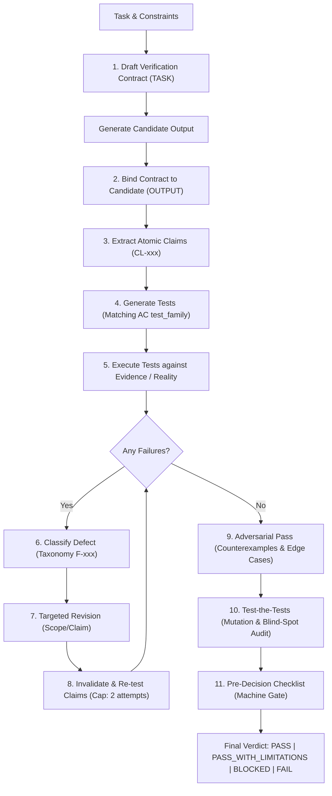

# agent-verification

[](https://github.com/metodoloji)
[](LICENSE)
[-blue?style=flat-square)](USER-GUIDE.md)
[-red?style=flat-square)](KULLANIM-KILAVUZU.md)
[](references/verification-contract.md)
[](references/state-machine.md)
[](references/failure-taxonomy.md)
[](references/verification-patterns.md)
[](references/verification-depth.md)
[](SKILL.md)

> **Do not treat verification as "read the answer again".**  
> Treat verification as an **adversarial test lifecycle** governed by binding contracts, explicit invariants, and multi-tier failure taxonomy.

📖 **Comprehensive User Manuals:**
* 🇬🇧 [**English User Guide (`USER-GUIDE.md`)**](USER-GUIDE.md) — Exhaustive scenarios, 18 pattern recipes, 4 depths, and prompt blueprints.
* 🇹🇷 [**Türkçe Kullanım Kılavuzu (`KULLANIM-KILAVUZU.md`)**](KULLANIM-KILAVUZU.md) — Tüm senaryolar, pratik kullanım örnekleri, rol bazlı prompt şablonları.

`agent-verification` is a contract-driven, adversarial self-audit protocol and agent skill for AI coding and reasoning systems. It replaces complacent model self-approval with a rigorous, machine-checkable audit pipeline: decomposing candidate outputs into atomic claims, attacking hypotheses with concrete counterexamples, auditing verification suites against mutations, enforcing mechanical invariants (`INV-001` .. `INV-091`), and narrating the work live — before issuing a final verdict.

---

## 📑 Table of Contents

- [The Core Problem](#-the-core-problem)
- [Verification Lifecycle](#-verification-lifecycle)
- [Key Architectural Pillars](#-key-architectural-pillars)
  - [1. The Verification Contract](#1-the-verification-contract)
  - [2. Multi-Tier Verification Depth](#2-multi-tier-verification-depth)
  - [3. 18 Verification Patterns](#3-18-verification-patterns)
  - [4. Adversarial Pass (The Attack)](#4-adversarial-pass-the-attack)
  - [5. Test-the-Tests (Audit & Mutation)](#5-test-the-tests-audit--mutation)
  - [6. Standardized Failure Taxonomy (31 Codes)](#6-standardized-failure-taxonomy-31-codes)
  - [7. Strict Lifecycle Invariants (`INV-001` .. `INV-091`)](#7-strict-lifecycle-invariants-inv-001--inv-091)
  - [8. Pre-Decision Gate & Checklist Closure](#8-pre-decision-gate--checklist-closure)
  - [9. Live Verification Trace (Visible Progress)](#9-live-verification-trace-visible-progress)
- [Decision Verdicts](#-decision-verdicts)
- [Repository Structure](#-repository-structure)
- [Usage & Integration](#-usage--integration)
  - [As an Agent Skill](#as-an-agent-skill)
  - [Activation Triggers](#activation-triggers)
  - [Output Policy](#output-policy)
- [Evaluation Suite](#-evaluation-suite)
- [Contributing](#-contributing)
- [License](#-license)

---

## ⚡ The Core Problem

Standard LLM self-verification suffers from **complacent self-confirmation**: when prompted with *"Are you sure?"* or *"Check your work"*, models routinely re-read their own generated text, confirm their existing priors, and falsely approve flawed logic or hallucinated facts (`VF-06 / VF-07`).

`agent-verification` replaces passive confirmation with an **active adversarial test harness**:
1. **Candidate Outputs are Untrusted by Default:** An output is merely a candidate until verified against evidence.
2. **Decomposition into Testable Claims:** Central conclusions are broken down into atomic, testable claims (`CL-001`, `CL-002`, ...).
3. **Tests Must be Capable of Falsification:** A test that cannot fail on a broken answer is rejected as weak (`INV-008`, `VF-02`).
4. **Revisions Invalidate Prior Tests:** Merely patching an answer does not verify it; all affected tests must be re-run (`INV-003`, `INV-048`).
5. **No Hallucinated Verification:** If runtime tools, compilers, or live data are inaccessible, the system must emit `BLOCKED`, never invent verification (`INV-010`).

---

## 🔄 Verification Lifecycle



### Revision Exhaustion Cap
To prevent endless hallucinated repair loops, consecutive failed re-tests on the same critical claim are strictly capped at **2 attempts**. Reaching the cap triggers an automatic terminal `FAIL` (or `BLOCKED` if external evidence/access is missing, per `INV-010 / INV-033`).

---

## 🧱 Key Architectural Pillars

### 1. The Verification Contract
Defined in [`references/verification-contract.md`](references/verification-contract.md), the **Verification Contract (v1.28)** is a formal, machine-readable data model that binds an unverified candidate output to its task requirements, decomposed claims, test suite, and outcome.

```json
{
  "contract_id": "vc_20261017_001",
  "contract_version": "1.28",
  "task": "Task restatement with explicit constraints",
  "risk_level": "STANDARD",
  "depth_executed": "STANDARD",
  "scope": "Explicit domain or boundary conditions",
  "acceptance_conditions": [
    {
      "id": "AC-001",
      "description": "Specific condition that must hold for acceptance",
      "critical": true,
      "test_family": "constraint",
      "test_ids": ["TEST-001"]
    }
  ],
  "claims": [
    {
      "id": "CL-001",
      "text": "Extracted testable claim from output",
      "critical": true,
      "evidence_ids": ["EV-001"],
      "test_ids": ["TEST-001"],
      "status": "VERIFIED"
    }
  ],
  "progress_trace": [
    {
      "seq": 1,
      "stage": "DEPTH",
      "status": "DONE",
      "summary": "STANDARD selected: code change with one testable claim.",
      "refs": ["AC-001"],
      "emitted": "LIVE"
    },
    {
      "seq": 2,
      "stage": "DECISION",
      "status": "DONE",
      "summary": "PASS: the single critical claim is verified by EV-001; no limitations.",
      "refs": ["EV-001"],
      "emitted": "LIVE"
    }
  ],
  "final_verdict": {
    "status": "PASS",
    "verified_at_depth": "STANDARD",
    "verdict_card": {
      "verdict": "PASS",
      "depth_executed": "STANDARD",
      "trace_status": "LIVE",
      "critical_claims_verified": 1,
      "critical_claims_total": 1,
      "tests_passed": 1,
      "tests_total": 1,
      "revisions": 0,
      "decisive_evidence_ids": ["EV-001"],
      "limitation_refs": [],
      "blocked_refs": [],
      "failure_refs": [],
      "rendered_counts": {"claims": "1/1", "tests": "1/1", "revisions": "0"},
      "rendered": "✅ PASS · STANDARD · LIVE\nCritical claims 1/1 · Tests 1/1 · Revisions 0\n[claims=1/1, tests=1/1, rev=0]"
    },
    "decisive_evidence_ids": ["EV-001"],
    "checklist_closure": true
  }
}
```

> [!NOTE]
> **Progress is part of the protocol, not a UI layer.** Every arrow in the diagram
> above emits a short user-visible update while the stage runs (`INV-057`); the
> machine record lives in `progress_trace[]` and must agree with the contract
> (`INV-058`). A verdict that arrives without a trace is a `VF-09` failure even
> when it is correct; a card whose numbers are typed by hand is `VF-10`
> (`INV-059`), and the trace is closed, redacted, and bounded (`INV-060`–`INV-062`)
> — see [Pillar 9](#9-live-verification-trace-visible-progress).

### 2. Multi-Tier Verification Depth
Documented in [`references/verification-depth.md`](references/verification-depth.md), verification depth is strictly calibrated to task risk:

| Depth | Risk Category | Mandatory Verification Steps |
|---|---|---|
| **`MINIMAL`** | Deterministic formatting, simple data extractions, mechanical syntax changes | Constraint & exclusion checks, format preservation |
| **`STANDARD`** | Default for code, factual research, comparative analysis, multi-step plans | Claim decomposition, evidence checks, logical entailment, lightweight attack |
| **`ADVERSARIAL`** | Complex recommendations, ambiguous requirements, high-uncertainty tasks | Full counterexample search, assumption audit, symmetry checks, suite audit |
| **`CRITICAL`** | Production deployments, database migrations, security & cryptography logic | External tool execution (compilers, linters), mental mutation testing, artifact attestation |

> [!IMPORTANT]
> **Depth Floor Rule (`INV-037`):** Never de-escalate depth simply because initial checks passed. If ambiguity exists, the agent must tie-break to the higher depth level.

### 3. 18 Verification Patterns
Documented in [`references/verification-patterns.md`](references/verification-patterns.md), agents select the smallest sufficient subset of test patterns capable of exposing real failures:

| # | Pattern | Description |
|---|---|---|
| **1** | **Constraint Verification** | Validates explicit requirements, exclusions, boundary conditions, and limits. |
| **2** | **Completeness Verification** | Ensures all required dimensions are covered without equating length with completeness. |
| **3** | **Claim-Evidence Verification** | Verifies that cited sources directly substantiate the specific scope of each claim. |
| **4** | **Assumption Audit** | Flags implicit premises; ensures dependencies are labeled `CONDITIONAL` or verified. |
| **5** | **Counterexample Search** | Actively constructs minimal realistic inputs or edge scenarios that disprove the claim. |
| **6** | **Logical Entailment** | Audits whether premises logically necessitate the conclusion without non-sequiturs. |
| **7** | **Consistency Verification** | Detects internal contradictions across disparate sections of the output. |
| **8** | **Comparison Symmetry** | Guarantees competing alternatives are judged under identical, fair criteria. |
| **9** | **Filtering Verification** | Audits selections for both False Positives (`OF-06`) and False Negatives (`OF-07`). |
| **10** | **Classification Verification**| Tests edge cases near class boundaries; ensures classes are mutually exclusive. |
| **11** | **Transformation Preservation**| Ensures code refactoring, translation, or schema rewrites preserve semantic invariants. |
| **12** | **Research Coverage** | Checks that technical surveys do not miss consensus positions or standard alternatives. |
| **13** | **Recommendation Verification**| Confirms that trade-offs, operational costs, and drawbacks are surfaced. |
| **14** | **External Reality Check** | Prefers compilers, linters, test runners, and live APIs over model self-belief. |
| **15** | **Mutation Testing** | Deliberately injects defects into candidate answers to verify test sensitivity. |
| **16** | **Verification-of-Verification** | Audits the verification test suite itself for circularity and blind spots. |
| **17** | **Evidence Boundary** | Explicitly catalogs `NOT CHECKED` items to prevent false confidence. |
| **18** | **Minimal Verification Principle**| Disables deep adversarial suites for trivial banter, greetings, and low-stakes formatting. |

### 4. Adversarial Pass (The Attack)
Instead of confirming why an answer is right, the agent actively attempts to falsify it:
- *What is the simplest realistic edge case where this breaks?*
- *Can I construct a concrete, reproducible counterexample?*
- *Is the claim broader than what the evidence actually proves?*

### 5. Test-the-Tests (Audit & Mutation)
Before emitting a verdict, the agent audits its verification suite:
- **Circularity Detection (`VF-03`):** Does the test verify against independent ground truth, or does it merely test whether the answer agrees with its own premises?
- **Mutation Sanity Check (`VF-02`):** If the claim is inverted or corrupted, does the test suite fail? If it still passes, the test is weak and cannot support the verdict.

### 6. Standardized Failure Taxonomy (31 Codes)
Detailed in [`references/failure-taxonomy.md`](references/failure-taxonomy.md), any detected defect is mapped to a standardized failure code:

* **Output Failures (`OUTPUT_FAILURE`):**
  `OF-01` (`WRONG_CLAIM`), `OF-02` (`MISSING_CLAIM`), `OF-03` (`UNSUPPORTED_CLAIM`), `OF-04` (`CONTRADICTION`), `OF-05` (`SCOPE_ERROR`), `OF-06` (`FALSE_POSITIVE`), `OF-07` (`FALSE_NEGATIVE`), `OF-08` (`INCOMPLETE`), `OF-09` (`UNJUSTIFIED_CERTAINTY`), `OF-10` (`CONSTRAINT_VIOLATION`).
* **Verification Failures (`VERIFICATION_FAILURE`):**
  `VF-01` (`MISSING_TEST`), `VF-02` (`WEAK_TEST`), `VF-03` (`CIRCULAR_TEST`), `VF-04` (`BLIND_SPOT`), `VF-05` (`BAD_COUNTEREXAMPLE`), `VF-06` (`PREMATURE_PASS`), `VF-07` (`FALSE_ACCEPTANCE`), `VF-08` (`FALSE_REJECTION`), `VF-09` (`SILENT_VERIFICATION`), `VF-10` (`MISREPORTED_CARD`).
* **Evidence Failures (`EVIDENCE_FAILURE`):**
  `EF-01` (`SOURCE_MISSING`), `EF-02` (`SOURCE_MISMATCH`), `EF-03` (`STALE_SOURCE`), `EF-04` (`INSUFFICIENT_SCOPE`), `EF-05` (`CONTRADICTORY_SOURCES`), `EF-06` (`CIRCULAR_EVIDENCE`).
* **Execution Failures (`EXECUTION_FAILURE`):**
  `XF-01` (`UNAVAILABLE_TOOL`), `XF-02` (`UNAVAILABLE_DATA`), `XF-03` (`TIMEOUT`), `XF-04` (`PERMISSION_BLOCKED`), `XF-05` (`ENVIRONMENT_MISMATCH`).

### 7. Strict Lifecycle Invariants (`INV-001` .. `INV-091`)
Detailed in [`references/state-machine.md`](references/state-machine.md), 91 invariants govern the state machine:
- **`INV-001` / `INV-002`:** `UNVERIFIED ≠ PASS` and `INCONCLUSIVE ≠ PASS`.
- **`INV-003` / `INV-048`:** Any claim mutation invalidates all dependent tests; stale test passes cannot support a revised verdict.
- **`INV-010`:** Never invent evidence or simulate checks; missing access strictly forces `BLOCKED`.
- **`INV-033`:** Revision attempts capped at 2 consecutive failures before terminal `FAIL` or `BLOCKED`.
- **`INV-035`:** A `PASS` cannot be emitted with unresolved critical failures or open blockers.
- **`INV-038` / `INV-039` / `INV-053`:** Strict bidirectional relational integrity between claims, acceptance conditions, tests, assumptions, and evidence.
- **`INV-045`:** Non-vacuous criticality; central conclusions cannot be classified as non-critical to evade gates.
- **`INV-051`:** Decisive evidence must be recorded as structured schema IDs in `final_verdict.decisive_evidence_ids[]`, never as prose alone.
- **`INV-056`:** At `CRITICAL` depth, external runtime checks and mutation tests must cite executed test IDs and observations, not narrative claims.
- **`INV-057` / `INV-058`:** The verification process must be narrated live at the depth's cadence (`VF-09` if silent or retro-fitted), and every trace entry must resolve to contract ids/states with a final `DECISION` matching `final_verdict.status`.
- **`INV-059` .. `INV-062`:** The verdict card is derived field-by-field (`VF-10` if hand-typed or incomplete), the trace closes with no dangling `RUNNING` stage, deferrals are honest, and trace content is redacted and bounded.
- **`INV-063` / `INV-064`:** Trace stages follow the lifecycle order and each cites its own artifact (`F-*`, `REV-*`, `TEST-*`, `EV-*`, typed external/mutation tests); out-of-order or generic narration is `VF-09`.
- **`INV-065` / `INV-066`:** The trace is complete for the executed depth (opening `DEPTH`, required stages, every failure/revision/escalation) and the card declares its provenance (depth + `LIVE`/`RETRO`); a short trace or provenance-blind card blocks the verdict.
- **`INV-067`:** The card's prose counts are verbatim: `rendered_counts` equals the formatted fields and the canonical `[claims=..., tests=..., rev=...]` footer appears exactly once, as the last line; a missing, duplicated, non-final, or conflicting footer is `VF-10`.
- **`INV-068`:** No defined test may be left unrun — every `tests[]` entry is terminal at verdict time, `INVALIDATED` is revision-backed, and `tests_total` counts only executed tests; a `PENDING`/`RUNNING` check is `VF-06`, because it would silently disappear from the card.
- **`INV-069`:** The card opens with the canonical header `<marker> <VERDICT> · <DEPTH> · <TRACE_STATUS>` (`✅`/`⚠️`/`⛔`/`❌`), carries exactly one whole verdict token on that line, and ends with the footer; a malformed header is `VF-10`.
- **`INV-070`:** The label matches its evidence — `PASS` has no limitations/blockers/open failures, `PASS_WITH_LIMITATIONS` has at least one limitation, `BLOCKED` has at least one blocker, and `FAIL` has at least one open failure id; a mismatch is `VF-10`.
- **`INV-071`:** An assumption may be `VERIFIED` only on reciprocated, scope-matching evidence (critical ones need an external/primary source or a recorded observation); flipping the status to lift a dependent claim is `EF-01`/`VF-07`.
- **`INV-072`:** `AS-XXX` is a legal limitation/blocker ref, and every critical `CONDITIONAL`/`UNVERIFIED` assumption must be named there — a condition that lives only in prose is undisclosed (`VF-04`/`VF-06`).
- **`INV-073`:** Escalation entries are directional — `UP` adds executed checks, `DOWN` drops checks and carries a `DOWNGRADE` limitation ref (`ESC-*`); the trace cites the matching artifact, so a downgrade can never masquerade as an escalation.
- **`INV-074`:** `checklist_closure: true` is valid only over a `checklist_results[]` record listing every §4 box once as `CHECKED` or `NA`-with-reason; a missing box or a reasonless `NA` is `VF-06` — the checklist is audited, not asserted.
- **`INV-075`:** A critical AC whose linked critical test `type` differs from its `test_family` must declare a `family_exceptions[]` entry with a non-empty reason; an undeclared mismatch is `VF-04` — "documented mapping" means a record, not an assumption that one exists.
- **`INV-076`:** Evidence records `observed_in_run`; a critical claim closes `VERIFIED` only with this run's evidence or an executed test's observation, while prior-run evidence caps the claim at `SUPPORTED` (`EF-03`) — INV-027 is now machine-checkable.
- **`INV-077`:** Every critical test declares its `ground_truth`; `SELF_AGREEMENT` and `CANDIDATE_RESTATEMENT` are `VF-03` and can never carry a critical PASS, and `DERIVATION` cannot be the sole support at ADVERSARIAL+ — INV-007 as a field.
- **`INV-078`:** Every revision records its `scope_delta`; dropping a critical AC/claim or downgrading the triggering failure's severity is `VF-07`, and each affected unit must be disclosed and re-gated — INV-026 as a field.
- **`INV-079`:** Every evidence item records its `origin`; a critical `VERIFIED` needs an `EXTERNAL_SOURCE`/`RUNTIME_OBSERVATION` item not derived from the candidate output, and a citation chain looping back to it is `EF-06`.
- **`INV-080`:** `attempt_number_for_claim` is derived (1 + prior revisions on the same claim since its last passing re-test) and never decreases; a reset counter is a cap escape (`VF-06`), and a PASS surviving only through it is `VF-07`.
- **`INV-081`:** `depth_steps[]` records every numbered step of `depth_executed` (`MINIMAL-1..4`, `STANDARD-1..6`, `ADVERSARIAL-1..7`, `CRITICAL-1..6`) as `DONE` with resolving trace/artifact refs or NA-with-reason; a missing or ref-less step is `VF-06` — INV-031 is a record, not an attestation.
- **`INV-082`:** Justification fields (limitation `detail`, blocker `blocked_on`/`evidence_required`, NA reasons, family `why`) must name the unit and the reason; placeholders are not reasons and cited refs must resolve (`VF-06`/`VF-04`).
- **`INV-083`:** Task, claim, and evidence scopes must be recorded and substantive; an empty or universal scope makes the scope match vacuous, so narrow evidence can never be stretched by leaving the scope blank (`EF-04`/`VF-04`).
- **`INV-084`:** `source_type` ↔ `origin` and `tests[].type` ↔ `ground_truth.kind` must agree with the mapping table — a citation cannot claim external origin while naming a local artifact, and an `external` test cannot rest on self-agreement (`VF-06`).
- **`INV-085`:** Every DONE `depth_steps[]` entry cites a terminal trace seq, and the cited seqs together cover the depth's required stages; a step record citing only the DECISION entry is `VF-06`/`VF-09`.
- **`INV-086`:** A failure's severity can only move through a revision's `scope_delta.severity_changes[]` entry (`from`/`to`/`why`, plus current-run evidence for a downgrade); an unrecorded edit is `VF-06`, a `PASS` resting on it is `VF-07`, and an unresolved `MAJOR`/`CRITICAL` finding blocks a clean `PASS` (`MAJOR` caps at `PASS_WITH_LIMITATIONS`, `CRITICAL` forces `FAIL`/`BLOCKED`) — severity is a record and a floor, not a dial.
- **`INV-087`:** A critical test's `falsifiability` names the wrong input and the result it would produce — not a placeholder, not a restatement of `purpose`/claim/observation, and not the same falsifier another critical test on that claim declares (`VF-02`).
- **`INV-088`:** Every trace `summary` names the unit it narrates (an id from its own `refs`, or the subject that ref names on a decision line such as `DEPTH`) and what was found; placeholder, stage-name-only, or duplicated summaries are `VF-09` — a trace that resolves but says nothing is not visibility.
- **`INV-089`:** Every declared id is unique within its array and carries that array's prefix (`AC-`/`CL-`/`AS-`/`TEST-`/`EV-`/`F-`/`REV-`/`ESC-`); a duplicate makes refs, reciprocal links, decisive evidence, and the card's derived counts name two units at once (`VF-06`), and a `PASS` resting on the duplicated unit is `VF-07`.
- **`INV-090`:** A critical test's `observation` states what was run or read (input, command, source) and what it returned; a placeholder (`PASS`, `verified`, `looks good`) or a sentence copied from another critical test on the same claim records no result (`VF-06`, `VF-07` when it carries the `PASS`) — `INV-018` forbids a bare `PASS`, this makes the recorded observation say something.
- **`INV-091`:** An assumption named in a `critical: true` claim's `assumption_ids[]` must itself be `critical: true`, so its status flows through the `INV-040` cap, the `INV-071` evidence floor, and the `INV-072` disclosure; demoting a load-bearing assumption to non-critical is `VF-04` — criticality follows the claim.

### 8. Pre-Decision Gate & Checklist Closure
Before issuing any `PASS` or `PASS_WITH_LIMITATIONS`, the machine-checkable Pre-Decision Checklist ([`references/verification-contract.md §4`](references/verification-contract.md#4-pre-decision-checklist-machine-checkable)) must evaluate all 73 gate checks. Any unchecked box leaves `checklist_closure: false` and mechanically blocks approval (`INV-028`). Non-applicable items must state explicit `N/A` reasons (`INV-032`).

### 9. Live Verification Trace (Visible Progress)
Specified in [`references/progress-protocol.md`](references/progress-protocol.md), the trace makes the verification lifecycle observable **while it runs**. The agent emits one short update per transition — before starting the work it describes — and records each update in `progress_trace[]`.

```text
🛡️ Verification · STANDARD · 1/7 · depth
STANDARD selected: code change plus a performance claim; no tie-break needed.

🛡️ Verification · STANDARD · 5/7 · failure
TEST-004 failed (OF-05 SCOPE_ERROR): the benchmark covers v2 only, the claim says "all versions".

🛡️ Verification · STANDARD · 6/7 · re-test
CL-002 narrowed to v2 (REV-001). TEST-004 invalidated; TEST-005 re-run on the revised claim → PASS.
```

- **Stream, don't summarize (`INV-057`):** a trace assembled at verdict time is `VF-09`; a silent run is a transparency failure even when the answer is right.
- **Trust moments are mandatory:** depth choice, first failed test, every revision + re-test, every escalation, and the verdict card.
- **Grounded (`INV-058`):** every entry resolves to contract ids/states and the final `DECISION` entry equals `final_verdict.status`.
- **Honest limits:** if the runtime cannot stream, record `emitted: "RETRO"` and disclose a `TRACE_DEFERRED` limitation — never fabricate a live stream.
- **Modes:** `concise` (default), `detailed` (ids + observations), `silent` (opening line + verdict card; trace still recorded).
- **Card is a view, not a source (`INV-059`):** every count and limitation ref is derived from the contract; hand-typed numbers or a hidden limitation are `VF-10`.
- **Closed and honest (`INV-060`/`INV-061`):** no dangling `RUNNING` stage, `DECISION` last; `TRACE_DEFERRED` only for an all-`RETRO` trace with a named runtime constraint, never a `MIXED` run.
- **Redacted and bounded (`INV-062`):** no credentials, tokens, or personal data in updates; summaries <= 280 characters and entry counts capped per depth.
- **Order and refs (`INV-063`/`INV-064`):** stages follow the lifecycle and each cites its own artifact; out-of-order narration or generic refs are `VF-09`.
- **Long stages heartbeat:** one "still running" update per minute, never fabricated progress.
- **Complete and self-describing (`INV-065`/`INV-066`):** the trace covers every failure/revision/escalation, and the card states the executed depth plus `LIVE`/`RETRO` so the user knows how rigorous and how live the run was.
- **Verbatim counts (`INV-067`):** the card's prose and its `[claims=..., tests=..., rev=...]` footer must match the structured fields exactly; the numbers a user reads cannot drift from the contract.
- **Closed suite and card grammar (`INV-068`–`INV-070`):** every defined test is terminal before the card; the card opens with the canonical marker/verdict/depth/trace header and closes with the footer; and its label matches its own limitation/blocker/failure arrays.
- **Scopes, declared facts, and step-trace agreement (`INV-083`–`INV-085`):** scopes are recorded so a scope match cannot be vacuous, declaration pairs (`source_type`/`origin`, test type/ground truth) must describe the same artifact, and the step record must cite trace coverage that actually exists.
- **Severity, falsifiers, and what the user reads (`INV-086`–`INV-088`):** a failure's severity only moves through a recorded, evidenced revision delta and an unresolved `MAJOR` finding caps the verdict; a critical test must name the wrong input it would catch; and every progress summary must name the unit it narrates — resolved ids with placeholder or repeated text is narration in form only.
- **One name, one unit (`INV-089`–`INV-091`):** identifiers are unique and correctly prefixed, so a citation or derived count can never silently point at two objects; a critical `observation` must record the check and its result rather than the word "verified"; and an assumption a critical claim depends on is itself critical, so its unresolved condition cannot escape the cap, evidence, and disclosure gates through a label.
- **Bookkeeping is derived (`INV-080`–`INV-082`):** the revision-attempt counter is computed from the revision history (no reset to dodge the cap), `depth_steps[]` records every step of the claimed depth with refs, and every justification field is substantive rather than a placeholder.
- **Anti-circularity (`INV-077`–`INV-079`):** declared test ground truth, recorded revision deltas, and independent evidence close the three paths where a system can "verify" itself without ever checking reality.
- **Records, not assertions (`INV-074`–`INV-076`):** the §4 checklist is a per-box record behind `checklist_closure`, a test-family mismatch is a declared exception with a reason, and every `VERIFIED` critical claim cites evidence observed in this run.
- **Assumptions and downgrades (`INV-071`–`INV-073`):** a `VERIFIED` assumption needs reciprocated evidence (status is a claim, not a permission flag), critical assumptions left conditional are named by `AS-XXX` in the limitations or blockers, and escalation entries are directional — an `UP` cites executed checks, a `DOWN` cites dropped checks and its `DOWNGRADE` ref.

---

## ⚖️ Decision Verdicts

Every verification cycle terminates in one of four mutually exclusive verdicts:

| Verdict | Semantics & Entry Conditions | Output Requirement |
|---|---|---|
| **`PASS`** | All critical ACs passed, all critical claims verified against decisive evidence, audit trail matches contract, live trace complete and grounded, zero open blockers. | Clean, unencumbered answer; decisive evidence IDs recorded in contract (`INV-051`). |
| **`PASS_WITH_LIMITATIONS`** | Core conclusion verified, but bounded non-critical gaps or assumptions exist. | Explicitly report all bounded limitations in user-facing output (`INV-047`, `INV-052`). |
| **`BLOCKED`** | Essential external tooling, compilers, or data sources are unavailable (`XF-01..05`). | Detail what was checked, what was blocked, and the exact evidence required (`INV-050`). |
| **`FAIL`** | Irreparable defect, constraint violation, or revision cap reached (≥ 2 attempts). | Cite the failed `AC-xxx` / `CL-xxx` and the standardized taxonomy code (`INV-050`). |

---

## 📂 Repository Structure

```text
agent-verification/
├── .gitignore                          # Standard git hygiene (OS, Python, IDE caches)
├── LICENSE                             # MIT License (Yunus Güngör / metodoloji)
├── README.md                           # Master architectural specification
├── USER-GUIDE.md                       # Comprehensive User Guide (English)
├── KULLANIM-KILAVUZU.md                # Kapsamlı Kullanıcı Kılavuzu (Türkçe)
├── SKILL.md                            # Agent Skill definition (prompts & operational lifecycle)
├── references/                         # Detailed formal specifications
│   ├── failure-taxonomy.md             # Standardized failure taxonomy (31 codes: OF, VF, EF, XF)
│   ├── state-machine.md                # Formal state transitions & 91 invariants (INV-001..INV-091)
│   ├── verification-contract.md        # Machine-readable Verification Contract schema (v1.28)
│   ├── progress-protocol.md            # Live Verification Trace: visible progress while verification runs
│   ├── verification-depth.md           # 4-tier risk classification & depth triggers
│   └── verification-patterns.md        # 18 concrete verification & adversarial patterns
└── evals/                              # Evaluation & benchmarking suite
    ├── activation-cases.md             # Benchmark cases for skill activation vs. bypass
    ├── cases.md                        # Concrete test vectors for adversarial verification
    └── scoring.md                      # Objective scoring rubrics & compliance criteria
```

---

## 🚀 Usage & Integration

### As an Agent Skill
This repository adheres to the standard Agent Skill format. It can be integrated into your agent environment immediately:

* **Claude Code / OpenHands:** Link or copy the folder into your project's skill directory (e.g. `.skills/agent-verification` or `.metodoloji/skills/agent-verification`).
* **Antigravity CLI / Codex:** Add the repository path to your active skill search paths.

### Activation Triggers
The skill automatically activates when generating:
* Factual claims, research synthesis, or technical recommendations
* Code modifications, architecture choices, database queries, or execution plans
* Comparisons, classifications, or entity filtering
* When the user explicitly requests to *verify*, *validate*, *audit*, *critique*, or *test* an output

*(Trivial greetings, informal banter, and low-stakes formatting are skipped).*

### Output Policy
- **Live Trace (default):** Emit one short progress update per lifecycle transition while verification runs (`INV-057`), plus a verdict card. The trace is not an internal log dump — decisions, findings, and changes only.
- **Clean Delivery:** After the trace, deliver the verified answer without replaying the whole contract or flooding the user with raw JSON.
- **Transparent Limitations:** Always surface bounded limitations, external assumptions, or unchecked boundary conditions when they affect trust.
- **Audit Trail for CRITICAL:** For `CRITICAL` depth verdicts, append a compact audit trail: depth executed, external check result, mutation outcome, and re-test status (`INV-030`, `INV-056`).
- **Silent on request only:** `silent` mode still emits the opening line and verdict card and still records `progress_trace[]`; silence is not the default and is never traceless.

---

## 🧪 Evaluation Suite

The [`evals/`](evals/) directory provides a comprehensive test suite to measure agent compliance against the protocol:
- **[`evals/activation-cases.md`](evals/activation-cases.md):** 20+ scenarios evaluating correct activation vs. appropriate bypass.
- **[`evals/cases.md`](evals/cases.md):** Full-lifecycle benchmark cases covering code correctness, factual claims, edge-case attacks, circularity traps, and revision caps.
- **[`evals/scoring.md`](evals/scoring.md):** Quantitative scoring rubrics measuring contract schema compliance, invariant enforcement, and classification precision.

---

## 🤝 Contributing

Contributions are welcome! To maintain protocol integrity:
1. All changes must preserve backward compatibility with invariants `INV-001` .. `INV-091`.
2. Schema updates must bump `contract_version` in [`references/verification-contract.md`](references/verification-contract.md) following semver rules.
3. Every new invariant or pattern must be accompanied by benchmark cases in [`evals/cases.md`](evals/cases.md).

---

## 📜 License

Distributed under the **MIT License**. See [`LICENSE`](LICENSE) for details.  
Copyright (c) 2026 Yunus Güngör ([metodoloji](https://github.com/metodoloji)).
