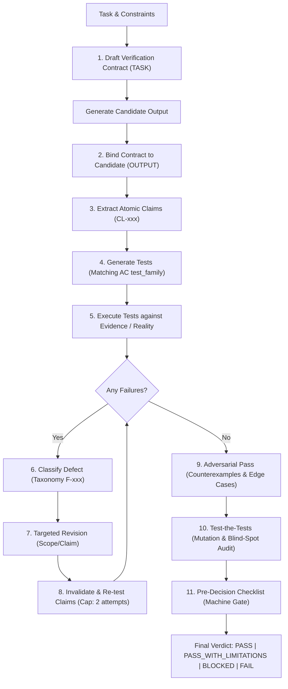

# agent-verification

[](https://github.com/metodoloji)
[](LICENSE)
[](references/verification-contract.md)
[](references/state-machine.md)
[](references/failure-taxonomy.md)
[](references/verification-patterns.md)
[](references/verification-depth.md)
[](SKILL.md)

> **Do not treat verification as "read the answer again".**  
> Treat verification as an **adversarial test lifecycle** governed by binding contracts, explicit invariants, and multi-tier failure taxonomy.

`agent-verification` is a contract-driven, adversarial self-audit protocol and agent skill for AI coding and reasoning systems. It replaces complacent model self-approval with a rigorous, machine-checkable audit pipeline: decomposing candidate outputs into atomic claims, attacking hypotheses with concrete counterexamples, auditing verification suites against mutations, and enforcing mechanical invariants (`INV-001` .. `INV-056`) before issuing a final verdict.

---

## 📑 Table of Contents

- [The Core Problem](#-the-core-problem)
- [Verification Lifecycle](#-verification-lifecycle)
- [Key Architectural Pillars](#-key-architectural-pillars)
  - [1. The Verification Contract](#1-the-verification-contract)
  - [2. Multi-Tier Verification Depth](#2-multi-tier-verification-depth)
  - [3. 18 Verification Patterns](#3-18-verification-patterns)
  - [4. Adversarial Pass (The Attack)](#4-adversarial-pass-the-attack)
  - [5. Test-the-Tests (Audit & Mutation)](#5-test-the-tests-audit--mutation)
  - [6. Standardized Failure Taxonomy (29 Codes)](#6-standardized-failure-taxonomy-29-codes)
  - [7. Strict Lifecycle Invariants (`INV-001` .. `INV-056`)](#7-strict-lifecycle-invariants-inv-001--inv-056)
  - [8. Pre-Decision Gate & Checklist Closure](#8-pre-decision-gate--checklist-closure)
- [Decision Verdicts](#-decision-verdicts)
- [Repository Structure](#-repository-structure)
- [Usage & Integration](#-usage--integration)
  - [As an Agent Skill](#as-an-agent-skill)
  - [Activation Triggers](#activation-triggers)
  - [Output Policy](#output-policy)
- [Evaluation Suite](#-evaluation-suite)
- [Contributing](#-contributing)
- [License](#-license)

---

## ⚡ The Core Problem

Standard LLM self-verification suffers from **complacent self-confirmation**: when prompted with *"Are you sure?"* or *"Check your work"*, models routinely re-read their own generated text, confirm their existing priors, and falsely approve flawed logic or hallucinated facts (`VF-06 / VF-07`).

`agent-verification` replaces passive confirmation with an **active adversarial test harness**:
1. **Candidate Outputs are Untrusted by Default:** An output is merely a candidate until verified against evidence.
2. **Decomposition into Testable Claims:** Central conclusions are broken down into atomic, testable claims (`CL-001`, `CL-002`, ...).
3. **Tests Must be Capable of Falsification:** A test that cannot fail on a broken answer is rejected as weak (`INV-008`, `VF-02`).
4. **Revisions Invalidate Prior Tests:** Merely patching an answer does not verify it; all affected tests must be re-run (`INV-003`, `INV-048`).
5. **No Hallucinated Verification:** If runtime tools, compilers, or live data are inaccessible, the system must emit `BLOCKED`, never invent verification (`INV-010`).

---

## 🔄 Verification Lifecycle



### Revision Exhaustion Cap
To prevent endless hallucinated repair loops, consecutive failed re-tests on the same critical claim are strictly capped at **2 attempts**. Reaching the cap triggers an automatic terminal `FAIL` (or `BLOCKED` if external evidence/access is missing, per `INV-010 / INV-033`).

---

## 🧱 Key Architectural Pillars

### 1. The Verification Contract
Defined in [`references/verification-contract.md`](references/verification-contract.md), the **Verification Contract (v1.14)** is a formal, machine-readable data model that binds an unverified candidate output to its task requirements, decomposed claims, test suite, and outcome.

```json
{
  "contract_id": "vc_20261017_001",
  "contract_version": "1.14",
  "task": "Task restatement with explicit constraints",
  "risk_level": "STANDARD",
  "depth_executed": "STANDARD",
  "scope": "Explicit domain or boundary conditions",
  "acceptance_conditions": [
    {
      "id": "AC-001",
      "description": "Specific condition that must hold for acceptance",
      "critical": true,
      "test_family": "constraint",
      "test_ids": ["TEST-001"]
    }
  ],
  "claims": [
    {
      "id": "CL-001",
      "text": "Extracted testable claim from output",
      "critical": true,
      "evidence_ids": ["EV-001"],
      "test_ids": ["TEST-001"],
      "status": "VERIFIED"
    }
  ],
  "final_verdict": {
    "verdict": "PASS",
    "verified_at_depth": "STANDARD",
    "decisive_evidence_ids": ["EV-001"],
    "checklist_closure": true
  }
}
```

### 2. Multi-Tier Verification Depth
Documented in [`references/verification-depth.md`](references/verification-depth.md), verification depth is strictly calibrated to task risk:

| Depth | Risk Category | Mandatory Verification Steps |
|---|---|---|
| **`MINIMAL`** | Deterministic formatting, simple data extractions, mechanical syntax changes | Constraint & exclusion checks, format preservation |
| **`STANDARD`** | Default for code, factual research, comparative analysis, multi-step plans | Claim decomposition, evidence checks, logical entailment, lightweight attack |
| **`ADVERSARIAL`** | Complex recommendations, ambiguous requirements, high-uncertainty tasks | Full counterexample search, assumption audit, symmetry checks, suite audit |
| **`CRITICAL`** | Production deployments, database migrations, security & cryptography logic | External tool execution (compilers, linters), mental mutation testing, artifact attestation |

> [!IMPORTANT]
> **Depth Floor Rule (`INV-037`):** Never de-escalate depth simply because initial checks passed. If ambiguity exists, the agent must tie-break to the higher depth level.

### 3. 18 Verification Patterns
Documented in [`references/verification-patterns.md`](references/verification-patterns.md), agents select the smallest sufficient subset of test patterns capable of exposing real failures:

| # | Pattern | Description |
|---|---|---|
| **1** | **Constraint Verification** | Validates explicit requirements, exclusions, boundary conditions, and limits. |
| **2** | **Completeness Verification** | Ensures all required dimensions are covered without equating length with completeness. |
| **3** | **Claim-Evidence Verification** | Verifies that cited sources directly substantiate the specific scope of each claim. |
| **4** | **Assumption Audit** | Flags implicit premises; ensures dependencies are labeled `CONDITIONAL` or verified. |
| **5** | **Counterexample Search** | Actively constructs minimal realistic inputs or edge scenarios that disprove the claim. |
| **6** | **Logical Entailment** | Audits whether premises logically necessitate the conclusion without non-sequiturs. |
| **7** | **Consistency Verification** | Detects internal contradictions across disparate sections of the output. |
| **8** | **Comparison Symmetry** | Guarantees competing alternatives are judged under identical, fair criteria. |
| **9** | **Filtering Verification** | Audits selections for both False Positives (`OF-06`) and False Negatives (`OF-07`). |
| **10** | **Classification Verification**| Tests edge cases near class boundaries; ensures classes are mutually exclusive. |
| **11** | **Transformation Preservation**| Ensures code refactoring, translation, or schema rewrites preserve semantic invariants. |
| **12** | **Research Coverage** | Checks that technical surveys do not miss consensus positions or standard alternatives. |
| **13** | **Recommendation Verification**| Confirms that trade-offs, operational costs, and drawbacks are surfaced. |
| **14** | **External Reality Check** | Prefers compilers, linters, test runners, and live APIs over model self-belief. |
| **15** | **Mutation Testing** | Deliberately injects defects into candidate answers to verify test sensitivity. |
| **16** | **Verification-of-Verification** | Audits the verification test suite itself for circularity and blind spots. |
| **17** | **Evidence Boundary** | Explicitly catalogs `NOT CHECKED` items to prevent false confidence. |
| **18** | **Minimal Verification Principle**| Disables deep adversarial suites for trivial banter, greetings, and low-stakes formatting. |

### 4. Adversarial Pass (The Attack)
Instead of confirming why an answer is right, the agent actively attempts to falsify it:
- *What is the simplest realistic edge case where this breaks?*
- *Can I construct a concrete, reproducible counterexample?*
- *Is the claim broader than what the evidence actually proves?*

### 5. Test-the-Tests (Audit & Mutation)
Before emitting a verdict, the agent audits its verification suite:
- **Circularity Detection (`VF-03`):** Does the test verify against independent ground truth, or does it merely test whether the answer agrees with its own premises?
- **Mutation Sanity Check (`VF-02`):** If the claim is inverted or corrupted, does the test suite fail? If it still passes, the test is weak and cannot support the verdict.

### 6. Standardized Failure Taxonomy (29 Codes)
Detailed in [`references/failure-taxonomy.md`](references/failure-taxonomy.md), any detected defect is mapped to a standardized failure code:

* **Output Failures (`OUTPUT_FAILURE`):**
  `OF-01` (`WRONG_CLAIM`), `OF-02` (`MISSING_CLAIM`), `OF-03` (`UNSUPPORTED_CLAIM`), `OF-04` (`CONTRADICTION`), `OF-05` (`SCOPE_ERROR`), `OF-06` (`FALSE_POSITIVE`), `OF-07` (`FALSE_NEGATIVE`), `OF-08` (`INCOMPLETE`), `OF-09` (`UNJUSTIFIED_CERTAINTY`), `OF-10` (`CONSTRAINT_VIOLATION`).
* **Verification Failures (`VERIFICATION_FAILURE`):**
  `VF-01` (`MISSING_TEST`), `VF-02` (`WEAK_TEST`), `VF-03` (`CIRCULAR_TEST`), `VF-04` (`BLIND_SPOT`), `VF-05` (`BAD_COUNTEREXAMPLE`), `VF-06` (`PREMATURE_PASS`), `VF-07` (`FALSE_ACCEPTANCE`), `VF-08` (`FALSE_REJECTION`).
* **Evidence Failures (`EVIDENCE_FAILURE`):**
  `EF-01` (`SOURCE_MISSING`), `EF-02` (`SOURCE_MISMATCH`), `EF-03` (`STALE_SOURCE`), `EF-04` (`INSUFFICIENT_SCOPE`), `EF-05` (`CONTRADICTORY_SOURCES`), `EF-06` (`CIRCULAR_EVIDENCE`).
* **Execution Failures (`EXECUTION_FAILURE`):**
  `XF-01` (`UNAVAILABLE_TOOL`), `XF-02` (`UNAVAILABLE_DATA`), `XF-03` (`TIMEOUT`), `XF-04` (`PERMISSION_BLOCKED`), `XF-05` (`ENVIRONMENT_MISMATCH`).

### 7. Strict Lifecycle Invariants (`INV-001` .. `INV-056`)
Detailed in [`references/state-machine.md`](references/state-machine.md), 56 invariants govern the state machine:
- **`INV-001` / `INV-002`:** `UNVERIFIED ≠ PASS` and `INCONCLUSIVE ≠ PASS`.
- **`INV-003` / `INV-048`:** Any claim mutation invalidates all dependent tests; stale test passes cannot support a revised verdict.
- **`INV-010`:** Never invent evidence or simulate checks; missing access strictly forces `BLOCKED`.
- **`INV-033`:** Revision attempts capped at 2 consecutive failures before terminal `FAIL` or `BLOCKED`.
- **`INV-035`:** A `PASS` cannot be emitted with unresolved critical failures or open blockers.
- **`INV-038` / `INV-039` / `INV-053`:** Strict bidirectional relational integrity between claims, acceptance conditions, tests, assumptions, and evidence.
- **`INV-045`:** Non-vacuous criticality; central conclusions cannot be classified as non-critical to evade gates.
- **`INV-051`:** Decisive evidence must be recorded as structured schema IDs in `final_verdict.decisive_evidence_ids[]`, never as prose alone.
- **`INV-056`:** At `CRITICAL` depth, external runtime checks and mutation tests must cite executed test IDs and observations, not narrative claims.

### 8. Pre-Decision Gate & Checklist Closure
Before issuing any `PASS` or `PASS_WITH_LIMITATIONS`, the machine-checkable Pre-Decision Checklist ([`references/verification-contract.md §4`](references/verification-contract.md#4-pre-decision-checklist-machine-checkable)) must evaluate all 39 gate checks. Any unchecked box leaves `checklist_closure: false` and mechanically blocks approval (`INV-028`). Non-applicable items must state explicit `N/A` reasons (`INV-032`).

---

## ⚖️ Decision Verdicts

Every verification cycle terminates in one of four mutually exclusive verdicts:

| Verdict | Semantics & Entry Conditions | Output Requirement |
|---|---|---|
| **`PASS`** | All critical ACs passed, all critical claims verified against decisive evidence, audit trail matches contract, zero open blockers. | Clean, unencumbered answer; decisive evidence IDs recorded in contract (`INV-051`). |
| **`PASS_WITH_LIMITATIONS`** | Core conclusion verified, but bounded non-critical gaps or assumptions exist. | Explicitly report all bounded limitations in user-facing output (`INV-047`, `INV-052`). |
| **`BLOCKED`** | Essential external tooling, compilers, or data sources are unavailable (`XF-01..05`). | Detail what was checked, what was blocked, and the exact evidence required (`INV-050`). |
| **`FAIL`** | Irreparable defect, constraint violation, or revision cap reached (≥ 2 attempts). | Cite the failed `AC-xxx` / `CL-xxx` and the standardized taxonomy code (`INV-050`). |

---

## 📂 Repository Structure

```text
agent-verification/
├── .gitignore                          # Standard git hygiene (OS, Python, IDE caches)
├── LICENSE                             # MIT License (Yunus Güngör / metodoloji)
├── README.md                           # Master architectural specification
├── SKILL.md                            # Agent Skill definition (prompts & operational lifecycle)
├── references/                         # Detailed formal specifications
│   ├── failure-taxonomy.md             # Standardized failure taxonomy (29 codes: OF, VF, EF, XF)
│   ├── state-machine.md                # Formal state transitions & 56 invariants (INV-001..INV-056)
│   ├── verification-contract.md        # Machine-readable Verification Contract schema (v1.14)
│   ├── verification-depth.md           # 4-tier risk classification & depth triggers
│   └── verification-patterns.md        # 18 concrete verification & adversarial patterns
└── evals/                              # Evaluation & benchmarking suite
    ├── activation-cases.md             # Benchmark cases for skill activation vs. bypass
    ├── cases.md                        # Concrete test vectors for adversarial verification
    └── scoring.md                      # Objective scoring rubrics & compliance criteria
```

---

## 🚀 Usage & Integration

### As an Agent Skill
This repository adheres to the standard Agent Skill format. It can be integrated into your agent environment immediately:

* **Claude Code / OpenHands:** Link or copy the folder into your project's skill directory (e.g. `.skills/agent-verification` or `.metodoloji/skills/agent-verification`).
* **Antigravity CLI / Codex:** Add the repository path to your active skill search paths.

### Activation Triggers
The skill automatically activates when generating:
* Factual claims, research synthesis, or technical recommendations
* Code modifications, architecture choices, database queries, or execution plans
* Comparisons, classifications, or entity filtering
* When the user explicitly requests to *verify*, *validate*, *audit*, *critique*, or *test* an output

*(Trivial greetings, informal banter, and low-stakes formatting are skipped).*

### Output Policy
- **Clean Delivery:** Do not flood the user with internal verification logs unless requested.
- **Transparent Limitations:** Always surface bounded limitations, external assumptions, or unchecked boundary conditions when they affect trust.
- **Audit Trail for CRITICAL:** For `CRITICAL` depth verdicts, append a compact audit trail: depth executed, external check result, mutation outcome, and re-test status (`INV-030`, `INV-056`).

---

## 🧪 Evaluation Suite

The [`evals/`](evals/) directory provides a comprehensive test suite to measure agent compliance against the protocol:
- **[`evals/activation-cases.md`](evals/activation-cases.md):** 20+ scenarios evaluating correct activation vs. appropriate bypass.
- **[`evals/cases.md`](evals/cases.md):** Full-lifecycle benchmark cases covering code correctness, factual claims, edge-case attacks, circularity traps, and revision caps.
- **[`evals/scoring.md`](evals/scoring.md):** Quantitative scoring rubrics measuring contract schema compliance, invariant enforcement, and classification precision.

---

## 🤝 Contributing

Contributions are welcome! To maintain protocol integrity:
1. All changes must preserve backward compatibility with invariants `INV-001` .. `INV-056`.
2. Schema updates must bump `contract_version` in [`references/verification-contract.md`](references/verification-contract.md) following semver rules.
3. Every new invariant or pattern must be accompanied by benchmark cases in [`evals/cases.md`](evals/cases.md).

---

## 📜 License

Distributed under the **MIT License**. See [`LICENSE`](LICENSE) for details.  
Copyright (c) 2026 Yunus Güngör ([metodoloji](https://github.com/metodoloji)).
